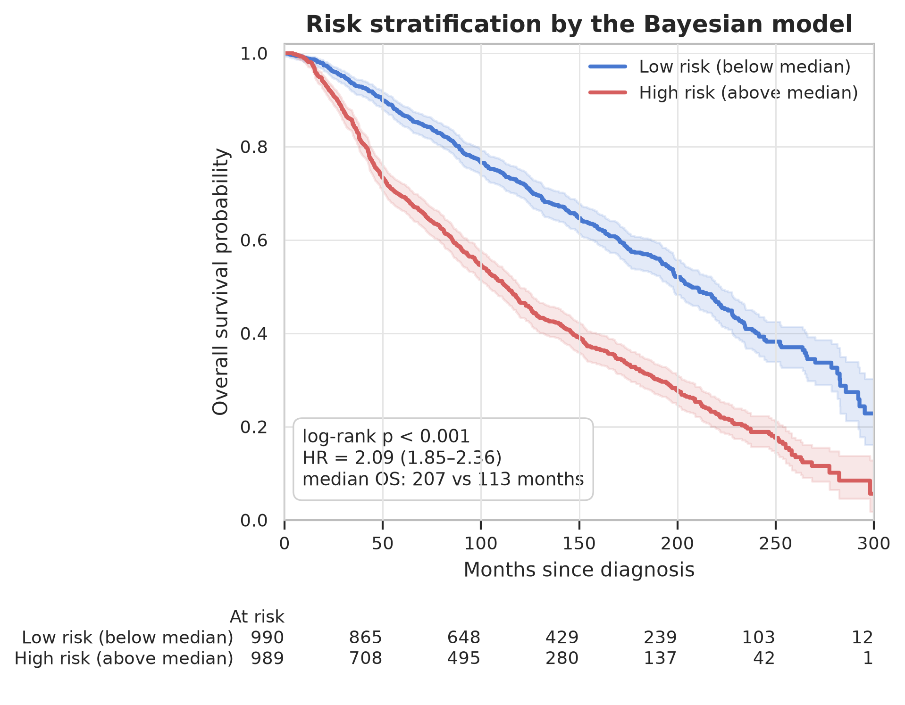
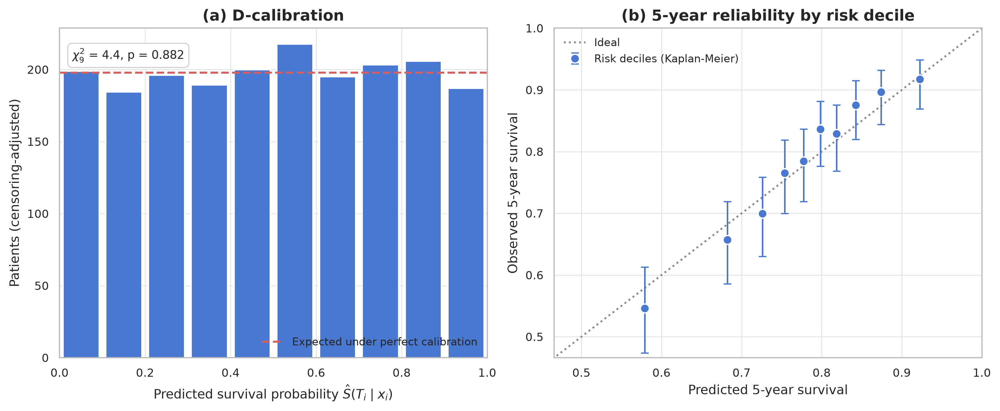
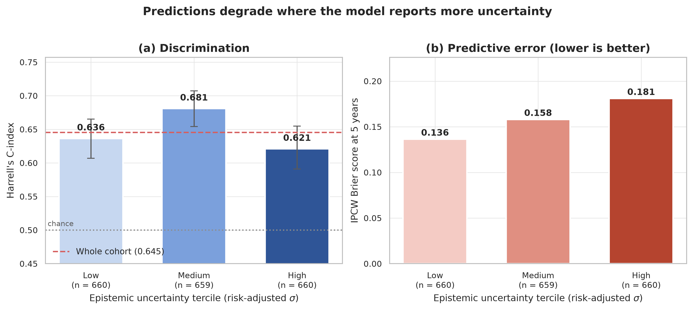
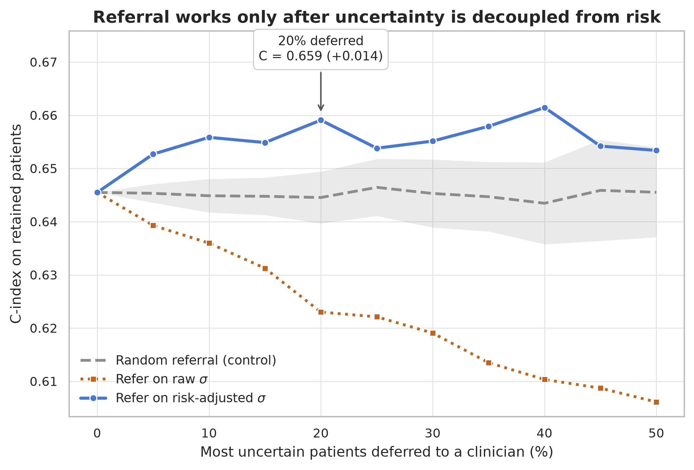
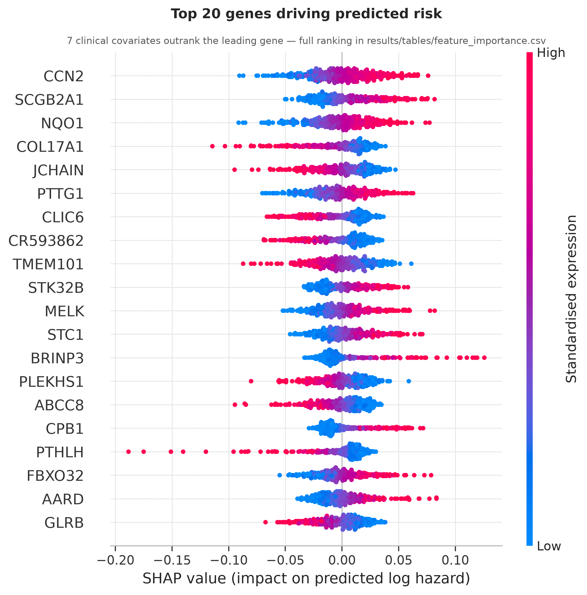

# 🧬🔬 Bayesian Deep Survival Modelling on METABRIC

**A Monte-Carlo-dropout survival network for breast cancer that reports how much it trusts each prediction — and an honest account of what that uncertainty is, and is not, good for.**

[](https://www.python.org/)
[](LICENSE)
[](run_all.sh)
[](https://www.cbioportal.org/study/summary?id=brca_metabric)

---

## What this is

A feed-forward network is trained on 1,000 transcripts plus 12 clinical covariates with a Cox
partial-likelihood loss. Dropout is left switched on at prediction time, so every patient receives
a *distribution* of risk scores rather than a point estimate. The width of that distribution is the
model's epistemic uncertainty, and the analysis below asks whether it can be used to decide which
patients a model should decline to score.

Everything is evaluated out-of-fold across 5-fold stratified cross-validation. Gene selection,
scaling, the network, the baseline hazard and the Cox comparator are **all** refitted inside each
fold, so no held-out patient influences anything that touches them.

## Headline results

| Model | C-index (95% CI) | 5-yr AUC | D-calibration *p* | Referral gain |
|---|---|---|---|---|
| ✅ Clinical Cox baseline (12 covariates) | **0.674** (0.658–0.691) | **0.707** | 0.947 | — |
| 📉 Bayesian MLP, 1,000 genes + clinical | 0.645 (0.628–0.662) | 0.686 | 0.882 | — |
| ↗️ &nbsp;&nbsp;+ uncertainty referral (top 20 % deferred) | 0.659 (0.640–0.678) | 0.697 | — | **+0.014** |

Three findings, stated plainly:

1. **Transcriptome-wide deep learning did not beat a 12-variable clinical Cox model** for overall
   survival on this cohort (0.645 vs 0.674). The clinical model wins in all five folds. Age, Nottingham
   prognostic index, nodal status and tumour size dominate the SHAP ranking; the best gene ranks 8th.
2. **Raw MC-dropout variance is not a usable confidence signal.** It correlates with prediction
   *magnitude* (r = 0.48 with |risk|), not with difficulty — so deferring the "most uncertain"
   patients strips out the easy-to-rank extremes and makes accuracy **worse** (0.645 → 0.623 at a
   20 % referral rate).
   Regressing the risk score out of σ fixes this, and referral then behaves as selective prediction
   predicts.
3. **The network's risk scores are badly over-dispersed.** The fitted van Houwelingen calibration
   slopes are 0.20–0.51 per fold (a well-specified model gives ≈ 1; the Cox comparator gives
   0.94–1.53). Without that shrinkage the survival probabilities fail D-calibration outright
   (χ² = 252, *p* < 10⁻¹⁵); with it they pass (*p* = 0.88).

## Figures

### Risk stratification

Median split on the out-of-fold risk score separates the cohort cleanly — hazard ratio 2.09
(1.85–2.36), log-rank *p* < 10⁻³⁴, median overall survival 207 vs 113 months.



### Calibration

After shrinkage the predicted survival distributions are uniform under the D-calibration test, and
predicted 5-year survival tracks the Kaplan-Meier estimate across risk deciles.



### Does uncertainty track error?

Yes, once σ is decoupled from the risk score. The Brier score rises monotonically across terciles.
The C-index panel is noisier — its value depends on how much risk spread each subgroup happens to
contain, and the confidence intervals overlap — which is exactly why both metrics are shown.



### Selective prediction

The contrast is the result. Deferring on **raw** σ tracks steadily downwards, below a random-referral
control. Deferring on **risk-adjusted** σ climbs above the control and stays there.



### What the model uses

Clinical covariates occupy the first seven ranks. Among genes, the top of the list is plausible for
breast cancer — *PTTG1* (proliferation/securin), *NQO1*, *COL17A1*, *JCHAIN* (plasma-cell
infiltration) and *CCN2/CTGF*.



## Method notes

Three details that materially changed the numbers, and are easy to get wrong:

**Pooling risk scores across folds.** A Cox risk score is identified only up to an additive shift
and a scale. Concatenating raw per-fold scores into one ranking mixes incompatible units and cost
about 0.02 C-index here (0.627 pooled vs 0.648 per-fold). Each fold is standardised against its own
calibration split before pooling; the map is monotone, so within-fold concordance is untouched.

**Calibrating absolute probabilities.** The early-stopping split cannot double as the calibration
split — the epoch is *chosen* to look good on it, which leaves its risk scores mildly optimistic and
drags the Breslow baseline down with them. The training fold is therefore split three ways:
70 % fit / 15 % early stopping / 15 % calibration. The Cox comparator goes through the identical
procedure so the two are compared on equal terms.

**De-confounding the uncertainty.** Dropout noise propagates roughly in proportion to how far a
prediction sits from the cohort centre, so raw σ is largely a restatement of |risk|. σ is regressed
on a quadratic in the risk score fold by fold and the residual is used. No survival outcome enters
that adjustment, so it cannot leak label information.

**Architecture.** The clinical covariates additionally reach the output through an undropped linear
term. A thousand noisy expression features otherwise drown out twelve strong clinical ones; the
shortcut lets the model fall back on a clinical Cox fit and spend the deep branch on whatever the
transcriptome adds. Ablating it costs ~0.007 validation C-index.

Hyperparameters (1,000 genes, hidden 256→64, dropout 0.5, lr 1e-3, weight decay 1e-3) were chosen by
grid search on the **inner validation** C-index only — never on held-out test folds.

## Reproducing

```bash
git clone <this repo> && cd bayesian-survival-metabric
conda env create -f environment.yml && conda activate metabric-survival   # or: pip install -r requirements.txt
bash run_all.sh
```

`run_all.sh` downloads METABRIC from the cBioPortal Data Hub (~500 MB), runs the cross-validated
training, and writes every figure and table. It takes about 15 minutes on four CPU cores; no GPU is
required. Results land in `results/`, a training log is written to the console and can be redirected to a file if desired.

To rerun only the analysis on existing predictions:

```bash
python -m src.train                 # writes results/oof_predictions.csv
python -m src.visualize             # figures + tables from that file
python -m src.visualize --skip-shap # skip the final-model refit
```

Training is seeded and reproduces bit-for-bit on CPU. `python check_reproducibility.py` retrains from
scratch and diffs the headline metrics against the committed
`results/tables/performance_metrics.csv`, which is the quickest way to confirm a change to `src/`
has not moved the numbers in this README.

## Layout

```
├── checkpoints/                 trained model weights (5 folds)
├── check_reproducibility.py     verify results match committed tables
├── data/
│   ├── download.sh              fetch + unpack METABRIC from cBioPortal
│   ├── brca_metabric/           raw cBioPortal data files
│   └── cache/                   preprocessed aligned data
├── environment.yml              conda environment
├── requirements.txt             pip dependencies
├── LICENSE
├── src/
│   ├── data_loader.py           parsing, alignment, fold‑local selection and scaling
│   ├── model.py                 Bayesian MLP, Cox loss, Breslow baseline hazard
│   ├── train.py                 cross‑validation, calibration, out‑of‑fold predictions
│   ├── uncertainty.py           C‑index, IPCW AUC/Brier, D‑calibration, referral
│   └── visualize.py             figures and result tables
├── notebooks/01_bayesian_survival_analysis.ipynb
├── results/
│   ├── figures/                 publication figures (300 dpi)
│   └── tables/                  metrics, gene ranking, referral curves
└── run_all.sh
```

## Limitations

Single cohort, no external validation — the calibration slopes below 0.5 say plainly that this
network is over-fitting 1.3k training patients, and the honest expectation is that the gap to the
clinical model would persist or widen elsewhere. Overall survival in METABRIC is heavily driven by
age and competing mortality, which favours the clinical covariates; relapse-free survival (available
in the same files) would be a fairer test of the transcriptome. The referral analysis assumes a
clinician handles deferred patients better than the model, which is asserted here rather than
measured.

## Data and references

Data: METABRIC, obtained from the [cBioPortal Data Hub](https://www.cbioportal.org/study/summary?id=brca_metabric).

- Curtis *et al.* The genomic and transcriptomic architecture of 2,000 breast tumours. *Nature* 486:346–352 (2012).
- Pereira *et al.* The somatic mutation profiles of 2,433 breast cancers. *Nature Communications* 7:11479 (2016).
- Gal & Ghahramani. Dropout as a Bayesian approximation. *ICML* (2016).
- Katzman *et al.* DeepSurv. *BMC Medical Research Methodology* 18:24 (2018).
- Haider *et al.* Effective ways to build and evaluate individual survival distributions. *JMLR* 21:1–63 (2020).
- van Houwelingen. Validation, calibration, revision and combination of prognostic survival models. *Statistics in Medicine* 19:3401–3415 (2000).

## License

MIT — see [LICENSE](LICENSE).
